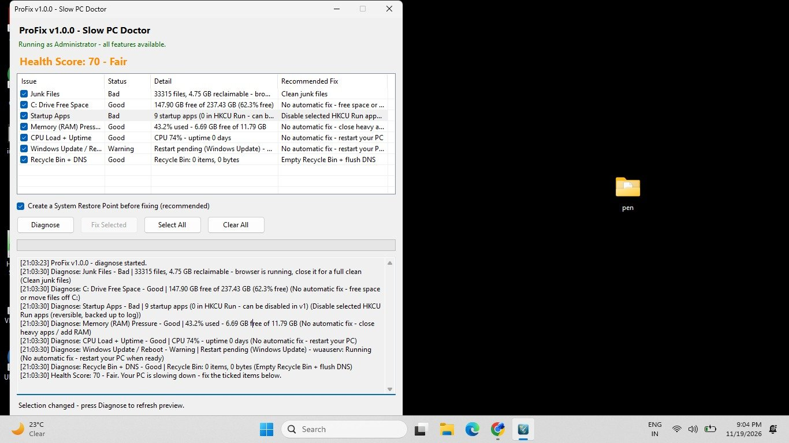

# ProFix v1.0.0 — Slow PC Doctor for Windows 10 / 11

A safe, free slow-PC doctor for Windows 10 and 11, by **PRO SUPPORT (Syed Osman)**.
Diagnose first, see a Health Score 0–100, then fix only the safe things
you tick. Nothing is changed until you press **Fix Selected**.

ProFix is the follow-up to [ProClean v1.1.0](https://github.com/syedosman07866/ProClean)
(the temp cleaner). It reuses ProClean's proven junk-collection and
safety logic, and adds the rest of the slow-PC checks: C: drive space,
startup apps, RAM, CPU + uptime, pending reboot, and Recycle Bin + DNS.

Two ways to run it — a real `.exe` (no install, no PowerShell) and a
single-file PowerShell script. Both do exactly the same thing.

## Download

| File | What it is |
|---|---|
| `ProFix.exe` | The program — double-click and it runs (the .NET 8 runtime is bundled inside, so nothing needs installing) |
| `ProFix.ps1` | The same tool as a single PowerShell 5.1 script (no install, built into Windows) |
| `Run-ProFix.bat` | Double-click launcher for the script version |
| `ProFix.ico` | The app icon — the ProClean badge reused for v1 (no new logo was made for v1) |
| `LICENSE` | MIT License |

## Screenshots



Real test on Syed's own PC, 19 Nov 2026 — Health Score 70 (Fair), Junk 33,315 files / 4.75 GB reclaimable.

## How to run (on your Windows 10/11 PC)

**The .exe (easiest):**
1. Download `ProFix.exe` and double-click it.
2. Windows SmartScreen may warn because the file is not code-signed —
   click **"More info"**, then **"Run anyway"**.
3. If it asks "Run as administrator?" — click **Yes** for the full fix
   (System Restore Point needs admin; without admin it stays disabled
   and the rest works).
4. Press **Diagnose**, review the Health Score and the list, tick the
   issues to fix, then press **Fix Selected**.
5. A log file is saved to your Desktop after every run
   (`ProFix-Log-YYYYMMDD-HHMMSS.txt`).

**The script:**
1. Copy the whole `ProFix` folder to your PC (Desktop is fine).
2. Double-click **`Run-ProFix.bat`** — or right-click `ProFix.ps1` →
   **Run with PowerShell**.
3. Same steps as above from step 3.

**Console diagnose (no window, changes nothing):**
- Script: `powershell -File ProFix.ps1 -DiagnoseOnly`
- Exe: `ProFix.exe /DIAGNOSE`
- Prints the Health Score and every check, exits 0.

**Silent safe fix (no window):**
- Script: `powershell -File ProFix.ps1 -AutoFix`
- Exe: `ProFix.exe /AUTO`
- Diagnoses, then fixes Junk + DNS only. It does **not** empty the
  Recycle Bin silently and does **not** disable any startup app
  silently. Makes a restore point only when run as admin, prints a
  summary and the log path, exits 0. Safe to put in Task Scheduler.

**Inspect before you fix:** double-click any row in the results.
- **Junk Files:** the 250 largest files (file path, size, last modified) — read-only.
- **Startup Apps:** a list of every startup app with its full command.
  Tick the HKCU Run apps you want to disable and press OK. HKLM Run
  and Startup Folder apps are shown for info only and cannot be
  disabled in v1.
- **Other rows:** an explanation of the check and its recommendation.

No installation. No internet needed. The code is open — read it before running.

## Safe by Design

Most PC optimizer tools show scary fake warnings or break Windows
with aggressive registry cleaning. ProFix does the opposite — honest,
reversible, and transparent. That is its biggest promise:

- **Honest, no fake warnings** — the Health Score is computed from
  10 real, named checks (7 software + 3 hardware) with the exact
  points shown in the tables below. Nothing is labelled "critical"
  or "infected" to scare you into clicking Fix. The 75/25 split
  makes the honesty visible: System Health (x/75) shows what a
  cleanup can fix, Hardware Health (y/25) shows what only a
  hardware upgrade can fix.
- **Reversible** — every startup app disabled by a Fix is backed up
  three ways: the full original value in
  `HKCU\Software\ProFix\DisabledStartup`, in the Desktop log, and in
  `%LOCALAPPDATA%\ProFix\ProFix_Restore.json`. The **Undo Last Fix**
  button restores them, then renames the backup so Undo cannot run
  twice. Deleted junk files cannot be restored — ProFix says so on
  screen, in the JSON, and in the report — so a System Restore Point
  is offered before every Fix.
- **Transparent** — Diagnose shows exactly what will be fixed before
  anything changes. Every run writes a Desktop log, and every Fix
  writes a Before vs After report with the score before → after.
- **Official Windows APIs only** — WMI / CIM queries, standard
  PowerShell and .NET calls, and the built-in `ipconfig /flushdns`.
  No registry cleaning, no process killing, no debloat scripts, no
  driver changes, no network code at all.
- **User confirmation before every change** — Fix Selected asks
  first, and emptying the Recycle Bin asks again on its own.

## The 10 diagnostics (7 software + 3 hardware)

| Issue | What it checks | Default ticked for fix |
|---|---|---|
| Junk Files | Temp (`%TEMP%`, `C:\Windows\Temp`, 24h skip) + browser caches (Chrome, Edge, Firefox, Opera, all profiles) + old logs 7+ days + shader cache 7+ days + error reports 7+ days | Yes |
| C: Drive Free Space | % free and GB free on the system drive | No — no automatic fix |
| Startup Apps | `Win32_StartupCommand` + HKCU/HKLM Run keys + Startup folder; name, command and location per app | No — pick apps in the detail dialog |
| Memory (RAM) Pressure | Total RAM, free RAM, % used | No — no automatic fix |
| CPU Load + Uptime | CPU % and days since last restart | No — no automatic fix |
| Windows Update / Reboot | Pending-reboot registry keys + `wuauserv` status; report only, never forces an update | No — no automatic fix |
| Recycle Bin + DNS | Recycle Bin count/size; DNS latency (one real lookup, ms) | No — Recycle Bin needs its own confirmation |
| Hardware: OS Drive | Boot drive type, read-only WMI/CIM (NVMe/SSD vs HDD vs Unknown) | No — no automatic fix |
| Hardware: Total RAM | Total physical RAM installed, read-only | No — no automatic fix |
| Hardware: Disk + CPU | SMART disk health + CPU threads + battery health, read-only | No — no automatic fix |

## Health Score — 75/25 Split

The big score is **Overall 0–100**, with two sub-bars underneath it:
**System Health (x/75)** — what software cleanup can fix — and
**Hardware Health (y/25)** — what only a hardware upgrade can fix.
That way a cleanup that works still shows a real jump, and an old
HDD / 4 GB RAM laptop never fakes a 98/100 after a cleanup.

### Part A — System Health (max 75)

| Check | Max | Points |
|---|---|---|
| C: Drive Free Space (GB **or** %) | 20 | 20: 40 GB+ or 20%+ · 15: 25–39 GB or 15–19.9% · 10: 15–24 GB or 10–14.9% · 5: 5–14 GB or 5–9.9% · 0: under 5 GB **and** under 5% |
| RAM Pressure (3-sec average) | 15 | 15: under 65% used · 10: 65–79% · 5: 80–89% · 0: 90%+ |
| Startup Apps (enabled, non-Microsoft only) | 12 | 12: 0–3 · 8: 4–6 · 4: 7–10 · 0: 11+ |
| CPU (5-sec avg) + Uptime | 10 | CPU: 5 (under 40%) · 3 (40–69%) · 1 (70–84%) · 0 (85%+) — Uptime: 5 (under 3 days) · 3 (3–6 days) · 1 (7–13 days) · 0 (14+ days) |
| Junk / Temp Files (24h+ safe files) | 8 | 8: under 500 MB · 6: 500 MB–1.9 GB · 3: 2–4.9 GB · 0: 5 GB+ |
| Windows Update / Pending Restart | 6 | 6: no pending reboot · 4: updates available, no reboot needed yet · 0: pending restart flag active |
| Recycle Bin + DNS latency | 4 | Recycle Bin: 2 (under 500 MB) · 1 (500 MB–2 GB) · 0 (2 GB+) — DNS: 2 (under 50 ms) · 1 (50–150 ms) · 0 (timeout / fail) |

### Part B — Hardware Health (max 25, all read-only WMI/CIM)

| Check | Max | Points |
|---|---|---|
| OS Boot Drive (C:) | 12 | 12: NVMe / SATA SSD · 7: Unknown / VM / eMMC · 0: Mechanical HDD |
| Total Physical RAM | 8 | 8: 16 GB+ · 5: 8–15 GB · 0: under 8 GB |
| Disk SMART + CPU / Battery | 5 | 5: SMART OK + 4+ CPU threads + battery 60%+ (laptops) · 2: dual-core CPU or battery under 60% · 0: SMART warning / failing |

### Hard caps (applied AFTER the total)

| Emergency | Cap | Alert |
|---|---|---|
| Disk SMART failing / predict failure | Final score = min(score, 39) → Poor | "Hard drive failure risk detected — backup data first!" |
| C: drive under 2 GB free | Final score = min(score, 44) → Poor | C: drive critically full — Windows pagefile / updates can fail |

**Grade:** 85–100 Excellent (green) · 65–84 Good (teal) · 45–64 Fair (amber) · 0–44 Poor (red).
Diagnose also shows **"1-Click Fix se +X points turant badhenge"** — the
points Fix can gain at once (junk + Recycle Bin + DNS + startup).

**Sampling:** CPU and RAM are never a 1-second snapshot (ProFix itself
spikes CPU on launch). Diagnose waits 1 second, then averages CPU %
and RAM % over 3–5 seconds. Diagnose takes ~5 seconds longer because
of this — the status bar says "Measuring CPU/RAM…" while it samples.
This fixes the real bug from Syed's Windows test, where a 1-second
CPU spike of 74% was shown as "Good".

**Non-admin fallback:** if the drive type or SMART status cannot be
read without admin rights, ProFix does not crash and does not score 0
— it uses drive Unknown (7 pts) and SMART Unchecked (5 pts), with the
note "Run as Administrator for full hardware diagnostics."

**Reference example (from the spec):** HDD + 8 GB RAM, C: 12 GB free
(4.8%), 9 startup apps, 85% RAM, 35% CPU, 11 days uptime, 3.8 GB
junk, pending restart, 1.5 GB Recycle Bin, DNS OK → **36 Poor
(26/75 + 10/25)**. After 1-Click Fix (5.3 GB freed, 6 startup apps
off) → **55 Fair (45/75 + 10/25)**. After a manual restart (uptime
0 days, reboot cleared, RAM 60%) → **75 Good (65/75 + 10/25)**,
with the note "SSD lagane par score 87 Excellent ho jayega."
Full formula: `SCORE_SPEC_75_25.md`.

## What Fix does — and what it deliberately does NOT do

**Fix does (only for ticked issues, after a confirmation dialog):**
- Clean junk — only the files found in the Diagnose scan, 24h rule for
  Temp, locked files skipped, no whole-drive wildcards.
- Disable selected startup apps — **only HKCU Run entries in v1**.
  Before removing one, its value is saved to
  `HKCU\Software\ProFix\DisabledStartup\<name>`, written in full to
  the log, and written to `%LOCALAPPDATA%\ProFix\ProFix_Restore.json`,
  so it can be put back with the **Undo Last Fix** button. HKLM Run
  and Startup-folder items are listed for info only and are never
  disabled in v1.
- Empty the Recycle Bin — only with its own extra confirmation — and
  flush the DNS cache.
- Optional System Restore Point before fixing (admin only, on by default).
- After every Fix, re-run Diagnose silently and write a Before vs
  After report (`ProFix-Report-YYYYMMDD-HHMMSS.txt` on the Desktop):
  Health Score before → after **with the System/75 + Hardware/25
  split before and after**, space freed, startup apps disabled,
  and the recommendations still open. The split is also saved in
  `%LOCALAPPDATA%\ProFix\ProFix_Restore.json` (`SoftwareScoreBefore`
  / `HardwareScoreBefore`).

**Fix does NOT do:**
- Kill any process, change any power plan, or auto-restart the PC.
- Touch the registry except the HKCU Run disable above.
- Delete all of Prefetch (ProFix does not touch Prefetch at all in v1).
- Force a Windows Update, delete restore points / shadow copies, or
  remove apps.
- Change anything for C: drive full, CPU high, RAM high, pending reboot
  or long uptime — those rows show a plain-English recommendation
  instead (for example "Restart your PC", "Close heavy apps / add RAM",
  "Free space or move files off C:").
- Send anything to the internet — it has no network code at all.

## Safety rules (built in, not optional)

- **Diagnose first, preview everything** — nothing is changed until you press Fix Selected.
- **Any tick change after a Diagnose disables Fix** until you press Diagnose again (stale-preview guard).
- **Files changed in the last 24 hours are never touched** (Temp).
- **Files in use are skipped**, never forced.
- **No whole-drive wildcards** — every delete is scoped to a named folder.
- **Startup disables are reversible** — backed up to the registry, to
  the log, and to `%LOCALAPPDATA%\ProFix\ProFix_Restore.json`.
- **Undo Last Fix button** — restores the startup apps disabled by
  the last fix from `ProFix_Restore.json`, then renames the backup to
  `ProFix_Restore-UNDONE-<timestamp>.json` so it cannot run twice.
  The button is only enabled when a backup with restorable apps exists.
- **Before vs After report** — after every Fix, ProFix re-runs
  Diagnose and writes `ProFix-Report-YYYYMMDD-HHMMSS.txt` to the
  Desktop (score before → after, space freed, startup apps disabled,
  recommendations still open). Plain text in v1.0.
- **Optional System Restore Point** before fixing (admin only, on by default).
- **Every run writes a log** to the Desktop.

## Building the .exe from source

Needs the .NET 8 SDK (Windows targeting pack downloads on first build):

```powershell
cd dotnet
dotnet publish -c Release -o publish
```

Output: `dotnet/publish/ProFix.exe` — self-contained single file,
`win-x64`, Windows GUI. Trimming is deliberately OFF: `System.Management`
(the restore-point code) is not trim-safe.

The script version needs no build — it is `ProFix.ps1` as-is.

## Files

| File | What it is |
|---|---|
| `ProFix.exe` | Compiled program (C# + WinForms, .NET 8) |
| `ProFix.ps1` | The tool as a PowerShell 5.1 + Windows Forms script |
| `dotnet/Program.cs` | C# source — a mirror of the script, same diagnostics, scoring and safety rules |
| `dotnet/ProFix.csproj` | C# project file |
| `dotnet/ProFix.ico` | App icon copy used by the .exe build |
| `Run-ProFix.bat` | Launcher for the script (admin check + UAC elevation + non-admin fallback) |
| `ProFix.ico` | App icon (the ProClean badge reused for v1) |
| `SCORE_SPEC_75_25.md` | The exact Health Score formula (75/25 split, tiers, caps, grades) |
| `LICENSE` | MIT License |
| `.gitignore` | Build outputs, the .exe and logs are not committed |

## What v1 leaves out (on purpose)

- No Prefetch cleaning (ProClean had 30+ day old Prefetch as an
  opt-in; ProFix v1 does not touch Prefetch at all).
- No Windows Update cache / Delivery Optimization cleaning (that is
  ProClean's job — run ProClean for it).
- No HKLM Run or Startup-folder disabling (info only in v1).
- No process killing, no driver or app management, no disk check.
  These are deliberately out of v1 for safety; they can be added in a
  later version only with the same preview + confirm + backup rules.

## Release roadmap

v1.0 stays lean on purpose — the 7 checks, the Health Score, the
safe Fix, Undo, and the Before/After report. Bigger features ship
later, only with the same preview + confirm + backup rules.

| Version | Focus | Features |
|---|---|---|
| v1.0.0 | Core | Current 7 Checks + Health Score + 1-Click Safe Fix + Undo Backup + Before/After Report |
| v1.1.0 | Hardware & Visibility | Hardware Check + Upgrade Advisor (OS drive HDD vs SSD/NVMe via MSFT_PhysicalDisk, RAM + empty slots via Win32_PhysicalMemory, Disk Health SMART via MSStorageDriver_FailurePredictStatus, Battery Health Design vs Full Charge Capacity, CPU cores/age, all read-only WMI/CIM, Impact Level High/Medium/OK incl. "no upgrade needed") + C: Drive Top Space Hogs X-Ray (read-only top 5 folders with Open Folder, user deletes) + Before/After HTML report + Browser Bloat Check + Read-only DISM /CheckHealth |
| v1.2.0 | Deep Control | Safe Background Apps Manager (hide system processes, group by app e.g. Chrome 14 processes / 1.8 GB, Graceful Close WM_CLOSE only never taskkill /F, Disable Auto-Start with backup, Safety Badges Green/Yellow/Red) + Reversible Windows Tweaks (Power Plan check Balanced/High Performance, Visual Effects toggle keeping Smooth edges ON, Storage Sense ON, Fast Startup + Uptime warning, SSD TRIM vs HDD Defrag verify-only) + Network Quick Check (Gateway Ping + Internet Ping 1.1.1.1 + Wi-Fi Signal % + DNS flush) |

## Official source

The GitHub repository linked from PRO SUPPORT is the **only official
download** for ProFix. Do not trust copies from other sites — they may be
modified. The PRO SUPPORT name and shield logo may not be used to endorse
unofficial forks or repackaged copies.

## License

MIT License — free to use, share and modify. See `LICENSE`.

## Version

v1.0.0 — 19 Nov 2026 — MIT license — by PRO SUPPORT (Syed Osman)
